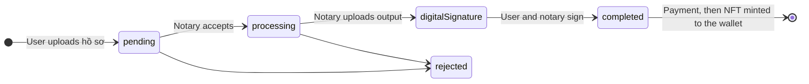
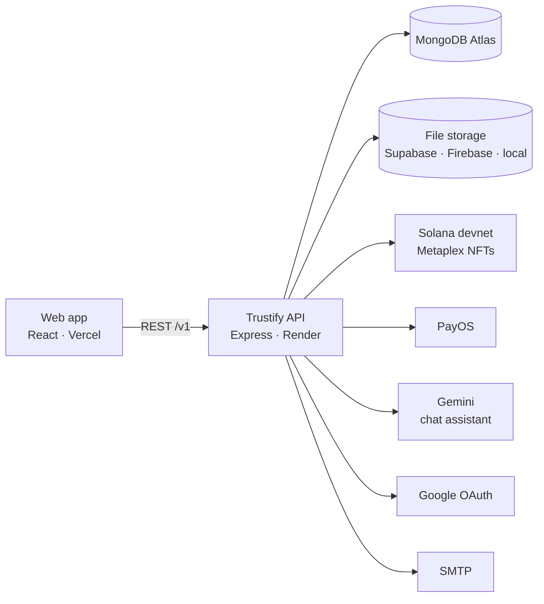

<div align="center">


### Trustify API

REST API for **Trustify**, an online notarization (công chứng trực tuyến) platform. It handles document intake, notary review and digital signatures, payment, and minting each notarized document as an NFT on Solana.

[](https://github.com/sloweyyy/Trustify-Backend/actions/workflows/ci.yml)
[](https://trustify-api-ar4i.onrender.com/health)
[](LICENSE)
[](https://deepwiki.com/sloweyyy/Trustify-Backend)

**[Live app](https://trustify-notary.vercel.app)** · **[API health](https://trustify-api-ar4i.onrender.com/health)** · **[Frontend](https://github.com/sloweyyy/Trustify-Frontend)** · **[Pitch deck](https://www.canva.com/design/DAGnFWahmVs/YdtYLPQEpEvYkGgjJCtqpg/view)**

</div>

## Contents

- [How it works](#how-it-works)
- [Architecture](#architecture)
- [Quick start](#quick-start)
- [Configuration](#configuration)
- [API overview](#api-overview)
- [Project structure](#project-structure)
- [Testing and CI](#testing-and-ci)
- [Deployment](#deployment)
- [QA environment](#qa-environment)

## How it works

A user submits a **hồ sơ** (notarization request) with the required documents. A notary reviews it, uploads the notarized output, and both sides sign. After payment, the output is stored and minted as an NFT that appears in the user's document wallet. Multi-party **sessions** follow the same path with several signers.



| Status | Label in the app |
|---|---|
| `pending` | Chờ xử lý |
| `processing` | Đang xử lý |
| `digitalSignature` | Chờ ký số |
| `completed` | Hoàn tất |
| `rejected` | Bị từ chối |

## Document privacy and verification

- **Documents stay private.** Uploads, notarized outputs and signatures go to a private bucket and are stored as `storage://<key>` references. API responses replace each reference with a short-lived signed link (`/v1/files/<key>?exp=…&sig=…`, 1 hour by default), so only someone who can read the record gets a working link.
- **Only a fingerprint is public.** Each minted NFT's metadata holds the file's SHA-256 hash, issuer and date, never the file, its name or a link to it.
- **Anyone can verify a copy.** `POST /v1/nft/verify-file` (multipart `file` + `mintAddress`) hashes the file in memory and compares it with the on-chain record: `match: true | false`, or `null` for records minted before fingerprints existed.
- Existing data was moved with `node scripts/migrate-private-storage.js --apply` (dry-run without `--apply`).

## Architecture



Every external service is **optional**. Without its keys the API falls back safely, so it runs locally with only MongoDB:

| Missing | Fallback |
|---|---|
| PayOS keys, or `PAYMENT_MODE=mock` | Checkout is simulated as paid, so the full flow still runs |
| Supabase / Firebase | Private files go to `./storage-private`; public NFT metadata to `./uploads` |
| Pinata | NFT metadata is stored in public file storage |
| SMTP | Emails are written to the log instead of sent |
| Google OAuth / Gemini | `/v1/auth/google` and `/v1/chatbot` return `503` |
| `WALLET_PRIVATE_KEY` | A throwaway keypair is generated; minting fails without devnet SOL |

## Quick start

**Requirements:** Node.js 20, and Docker (or any MongoDB).

```bash
git clone https://github.com/sloweyyy/Trustify-Backend.git
cd Trustify-Backend
yarn install

docker run -d --name trustify-mongo -p 27017:27017 mongo:6
cp .env.example .env          # minimal: NODE_ENV, PORT, MONGODB_URL, JWT_SECRET

yarn seed                     # notarization catalog + QA accounts
yarn dev                      # http://localhost:3000 (Swagger at /v1/docs in development)
```

Check the whole flow end to end: upload → review → sign → pay → mint NFT.

```bash
PAYMENT_MODE=mock yarn dev
API_URL=http://localhost:3000/v1 node scripts/smoke-e2e.js
```

> Running the web app locally too? It also defaults to port 3000, so start the API with `PORT=3100` and point the frontend at `http://localhost:3100/v1`.

| Command | What it does |
|---|---|
| `yarn dev` | Start with nodemon (development mode; Swagger enabled) |
| `yarn start:prod` | Start with plain Node (used in production) |
| `yarn test` | Jest unit and integration tests (needs MongoDB) |
| `yarn lint` | ESLint |
| `yarn seed` | Upsert 10 fields, 45 services and 4 QA accounts (safe to re-run) |
| `node scripts/smoke-e2e.js` | End-to-end API check, including a devnet NFT mint |
| `node scripts/get-balance.js` | Devnet wallet balance |

## Configuration

Copy `.env.example`; every variable is documented there. The important groups:

| Variable | Required | Notes |
|---|---|---|
| `MONGODB_URL`, `JWT_SECRET` | ✅ | The only hard requirements |
| `CLIENT_URL`, `SERVER_URL` | Production | Used for redirects, email links and local file URLs |
| `STORAGE_DRIVER`, `SUPABASE_URL`, `SUPABASE_SERVICE_ROLE_KEY` | Optional | `supabase`, `firebase` or `local`; auto-detected from keys |
| `SUPABASE_BUCKET`, `SUPABASE_PUBLIC_BUCKET` | Optional | Private document bucket (default `trustify-documents`) and public metadata bucket (default `trustify`) |
| `FILE_URL_TTL_SECONDS`, `FILE_URL_SECRET` | Optional | Signed file link lifetime (default 3600) and signing secret (default `JWT_SECRET`) |
| `SOLANA_CLUSTER_URL`, `WALLET_PRIVATE_KEY` | Optional | Base64 secret key of a wallet with devnet SOL |
| `PAYOS_CLIENT_ID`, `PAYOS_API_KEY`, `PAYOS_CHECKSUM_KEY`, `PAYMENT_MODE` | Optional | Real PayOS checkout, or `mock` |
| `GEMINI_API_KEY`, `GEMINI_MODEL` | Optional | Chat assistant (default model `gemini-3.5-flash`) |
| `GOOGLE_CLIENT_ID`, `GOOGLE_CLIENT_SECRET`, `GOOGLE_CALLBACK_URL` | Optional | "Sign in with Google" |
| `SMTP_*`, `EMAIL_FROM` | Optional | Transactional email |
| `PINATA_API_KEY`, `PINATA_SECRET_KEY` | Optional | Store NFT metadata on IPFS |

## API overview

All routes are under `/v1`. Swagger UI is served at `/v1/docs` in development only. Health check: `GET /health`.

| Prefix | Purpose |
|---|---|
| `/auth` | Register, login, refresh, password reset, email verification, Google OAuth |
| `/users` | User accounts and profile |
| `/notarization-fields`, `/notarization-services` | Notarization catalog (fields, services, required documents, prices) |
| `/notarization` | Hồ sơ upload, status, notary review, digital signatures |
| `/session` | Multi-party notarization sessions |
| `/payments` | PayOS checkout, callback, a user's own payments |
| `/userWallet`, `/nft` | Document wallet, NFT transfer and purchase, on-chain metadata |
| `/notary`, `/admin/metrics` | Notary and admin dashboards |
| `/chatbot` | Gemini-powered assistant (Vietnamese notarization FAQ) |
| `/role`, `/email` | Roles and email helpers |

Roles: `user`, `notary`, `admin` (see `src/config/roles.js`).

## Project structure

```
src/
├── index.js / app.js     # Server bootstrap, middleware, /health, /uploads
├── config/               # env, passport, roles, storage drivers, PayOS, Solana, Firebase
├── routes/v1/            # Express routers with Swagger annotations
├── controllers/          # HTTP layer
├── services/             # Business logic (notarization, session, payment, wallet, cron…)
├── models/               # Mongoose schemas
├── middlewares/          # auth, validation, rate limiting, error handling
├── validations/          # Joi schemas
└── seed/catalog.json     # 10 fields / 45 services from the business requirements
scripts/                  # seed, end-to-end smoke test, devnet wallet tools
tests/                    # Jest unit + integration tests
```

## Testing and CI

```bash
yarn test
```

GitHub Actions (`.github/workflows/ci.yml`) runs the full suite against a MongoDB service on every push and PR. GitGuardian scans every PR for secrets.

## Deployment

The QA stack runs entirely on free tiers:

| Piece | Service | Notes |
|---|---|---|
| API | Render web service (`render.yaml`) | Node 20, `node src/index.js`, health check `/health`, auto-deploys from `main` |
| Database | MongoDB Atlas M0 | Network access `0.0.0.0/0`, because Render's free tier has no static IPs |
| Files | Supabase Storage | Private bucket `trustify-documents` (documents), public bucket `trustify` (NFT metadata only) |
| Web app | Vercel | See the [frontend repo](https://github.com/sloweyyy/Trustify-Frontend) |
| NFTs | Solana devnet | Wallet funded with devnet SOL |

After deploying, seed the database once:

```bash
MONGODB_URL=<atlas-url> yarn seed
```

A `Dockerfile` (Node 20 Alpine) is included for container hosts.

## QA environment

| | |
|---|---|
| Web app | https://trustify-notary.vercel.app |
| API | https://trustify-api-ar4i.onrender.com (sleeps after 15 minutes idle; the first request takes about a minute) |

| Role | Email | Password |
|---|---|---|
| Admin | `trustify.admin@example.com` | `Trustify@123` |
| Notary | `trustify.notary@example.com` | `Trustify@123` |
| User | `trustify.user@example.com`, `trustify.user2@example.com` | `Trustify@123` |

## License

[MIT](LICENSE) © Phuc Truong Le Vinh
